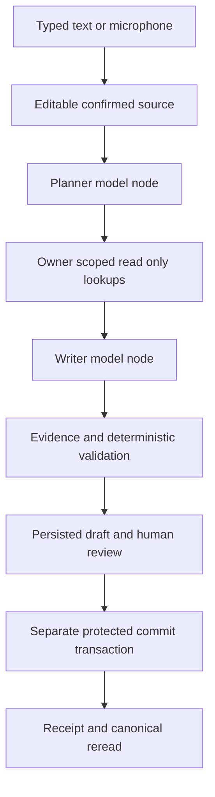

# DayBook architecture

The product has one Next.js application and one authoritative PostgreSQL database. The local-only PGlite adapter executes the same migrations and functions for synthetic replay. Production requires a conventional PostgreSQL connection and verified Supabase authentication.

## Boundaries

| Layer              | Authority and stored facts                                                                                                                                  |
| ------------------ | ----------------------------------------------------------------------------------------------------------------------------------------------------------- |
| Browser            | Captures audio, edits text/forms, submits an explicit review decision. Never supplies trusted journal lines or owner identity.                              |
| Supabase Auth      | Verifies existing account credentials; server verifies the access token before database access. Local HMAC sessions exist only outside production.          |
| Planner            | Proposes ordered operation kinds and allowed lookup enums, with exact source substrings. Has no database, filesystem, arbitrary HTTP or payment tool.       |
| Lookup registry    | Receives an already owner-scoped context, returns at most 20 results per allowed tool in one round. Current filtering is conservative and limited.          |
| Writer             | Produces one strict typed draft or rejection per authorized mutation step. Has no write tools.                                                              |
| Deterministic code | Validates literal evidence, normalizes exact money/dates, resolves labels uniquely, checks claims/dependencies, builds review effects and a canonical hash. |
| Database           | Independently reconstructs financial journal lines; owns all balances, claims, bill lifecycle and immutable history.                                        |
| Observability      | Receives only allowlisted metadata and statuses from manually instrumented spans. Failure never re-invokes a financial operation.                           |

## Approval binding and transaction ordering

The source is immutable after capture. Edits create a successor version with the original reference instant and reject the prior open draft. Form edits increment draft version and remove preview/hash state. The UI disables approval when source or form changes are unsaved. Source changes must be confirmed and interpreted again.

The preview binds normalized actions, source version, draft version, workspace revision and duplicate acknowledgement in a SHA-256 digest. Only server-written previews can reach `VALIDATED_PREVIEW`. The separate commit request passes version, digest, revision, the server-issued key and explicit approval. It contains no trusted financial lines.

`private.commit_batch` checks owner, locks the workspace row first, then the draft, checks receipts for identical replay, validates state/version/digest/revision/expiry and source ancestry, and compiles each action. It appends all entries/lifecycle records and one receipt atomically. Deferred database triggers enforce at least two nonzero balanced lines per entry, and composite foreign keys enforce account/entry workspace agreement. Cash balances are checked for every historical booked day after the batch. Any error rolls the complete transaction back.

Identical repeat approval returns the original receipt, including after a lost client response. Changing a key does not permit a second commit of the same draft. Reusing an existing key for a different draft or payload conflicts. A stale workspace revision requires a new preview. Server rereads the receipt and referenced journal records after posting.

## Financial conventions

Signed asset/expense/receivable debits are positive; income/equity credits are negative. INR amounts remain bigint internally and decimal strings at JSON boundaries. Transfers debit one owned asset and credit another. Shared payment personal share is an expense; others' shares create explicit claims. Settlement decreases receivable and increases the receiving asset; it is not income. A bill is a planning record until one linked payment entry exists. Cash count records an observation only.

Reversal is exact sign inversion of original lines with a unique `reverses_id`. Expense/income corrections append a reversal and replacement in one transaction. Settled shared-payment/loan reversal is blocked by canonical lifecycle links. Reversing a settlement or bill payment reopens the original claim/bill through derived active-event views.

Day close stores an immutable snapshot and preserves unresolved counted-cash differences. An explicit audited reopen is necessary before posting on a closed date. Reclosing appends a new snapshot; it never edits the original snapshot or forces a balancing expense.

## Source files

| Path                                        | Role                                                               |
| ------------------------------------------- | ------------------------------------------------------------------ |
| `app/ui/daybook.tsx`, `recorder.tsx`        | Workspace, editable review, browser recording                      |
| `app/api/*`                                 | Strict authenticated route handlers                                |
| `lib/agent/contracts.ts`                    | Strict v2.1 Planner/Writer contracts and evidence checks           |
| `lib/agent/graph.ts`, `providers.ts`        | Bounded orchestration, eligible provider selection                 |
| `lib/agent/prompts/*`                       | Verbatim authoritative versioned prompts                           |
| `lib/ledger/preview.ts`                     | Deterministic normalization and preview                            |
| `lib/workflow.ts`                           | Durable sources, runs, drafts, review and verified posting         |
| `lib/db.ts`, `auth.ts`                      | Verified identity and restricted database transactions             |
| `supabase/migrations/*`                     | Standalone schema, RLS, invariants, lifecycle and posting          |
| `instrumentation.ts`, `lib/observability/*` | Metadata-only Langfuse spans and isolated flush                    |
| `fixtures/evaluation.ts`                    | 72 labeled instructions, 15 holdout cases, 15 mocked voice scripts |

The model has no authority to approve, post, calculate an authoritative balance, call SQL or select an ambiguous immutable target. Live provider behavior and deployed security still require the blocked gates in BUILD_EVIDENCE.md.
